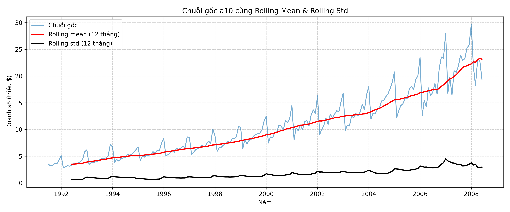

# Báo cáo Thực hành - Bài 2: Kiểm định ADF trên chuỗi gốc

> Notebook thực thi: [`notebooks/02_adf_test.ipynb`](../notebooks/02_adf_test.ipynb)

## 1. Mục tiêu

Kiểm định định lượng xem chuỗi doanh số gốc `a10` (204 quan sát hàng tháng, 07/1991 - 06/2008) có **dừng** hay không bằng kiểm định Augmented Dickey-Fuller (ADF), để xác nhận nhận định trực quan ở Bài 1 (chuỗi có xu hướng tăng, phương sai mở rộng).

Cấu hình: `adfuller(series, regression='c', autolag='AIC')` - mô hình có hằng số, số độ trễ chọn tự động theo tiêu chí AIC.

## 2. Giả thuyết kiểm định

| | Nội dung |
| :--- | :--- |
| $H_0$ (giả thuyết gốc) | Chuỗi **có nghiệm đơn vị** (unit root) $\Rightarrow$ **không dừng** |
| $H_1$ (đối thuyết) | Chuỗi **không có nghiệm đơn vị** $\Rightarrow$ **dừng** |

**Bản chất:** ADF ước lượng hồi quy

$$\Delta y_t = \alpha + \gamma y_{t-1} + \sum_{i=1}^{k} \delta_i \Delta y_{t-i} + \varepsilon_t$$

và kiểm định $H_0: \gamma = 0$ (có nghiệm đơn vị) so với $H_1: \gamma < 0$ (dừng). Các số hạng $\Delta y_{t-i}$ được thêm vào để loại bỏ tự tương quan trong phần dư. Đây là kiểm định **một phía**: chỉ giá trị thống kê **âm đủ lớn** mới là bằng chứng chống lại $H_0$.

## 3. Kết quả

| Chỉ số | Giá trị |
| :--- | :---: |
| **ADF Statistic** | **3.1452** |
| **p-value** | **1.0000** |
| Số lag sử dụng (AIC) | 15 |
| Số quan sát dùng trong hồi quy | 188 |

**Giá trị tới hạn (Critical Values):**

| Mức ý nghĩa | Giá trị tới hạn | ADF Statistic < Giá trị tới hạn? | Quyết định |
| :---: | :---: | :---: | :--- |
| 1% | -3.4656 | Không (3.1452 > -3.4656) | Không bác bỏ $H_0$ |
| 5% | -2.8770 | Không (3.1452 > -2.8770) | Không bác bỏ $H_0$ |
| 10% | -2.5750 | Không (3.1452 > -2.5750) | Không bác bỏ $H_0$ |

## 4. Giải thích ý nghĩa p-value

- **p-value** là xác suất thu được một giá trị thống kê ADF cực đoan bằng hoặc hơn giá trị quan sát được, **giả sử $H_0$ đúng** (chuỗi có nghiệm đơn vị).
- Quy tắc quyết định với mức ý nghĩa $\alpha = 0.05$:
  - $p < 0.05$: bác bỏ $H_0$ $\Rightarrow$ chuỗi dừng.
  - $p \ge 0.05$: không đủ bằng chứng bác bỏ $H_0$ $\Rightarrow$ chuỗi không dừng.
- Ở đây $p = 1.0000 \gg 0.05$: nếu chuỗi thực sự có nghiệm đơn vị thì việc thấy kết quả như vậy là hoàn toàn bình thường, nên **không có cơ sở bác bỏ $H_0$**.
- Lưu ý: p-value **không phải** xác suất để $H_0$ đúng, và "không bác bỏ $H_0$" không đồng nghĩa "chứng minh $H_0$ đúng" - chỉ là dữ liệu không cung cấp đủ bằng chứng cho tính dừng.

## 5. Kết luận tính dừng

1. **ADF Statistic = 3.1452 lớn hơn cả ba giá trị tới hạn** (-3.4656; -2.8770; -2.5750). Thống kê thậm chí mang dấu dương, rất xa vùng bác bỏ.
2. **p-value = 1.0000 > 0.05**.
3. Cả hai tiêu chí cùng dẫn đến **không bác bỏ $H_0$** ở mọi mức 1%, 5%, 10%.

$\Rightarrow$ **Chuỗi doanh số gốc `a10` KHÔNG DỪNG** (có nghiệm đơn vị). Kết luận này khớp với quan sát ở Bài 1 và với đồ thị rolling statistics: rolling mean tăng liên tục theo thời gian, rolling std cũng tăng dần, tức kỳ vọng và phương sai đều không ổn định.

**Kiểm tra độ bền:** chạy lại với `regression='ct'` (hằng số + xu hướng tuyến tính) cho ADF Statistic = 1.0944, p-value = 1.0000, giá trị tới hạn 1% / 5% / 10% lần lượt là -4.0077 / -3.4341 / -3.1409 $\Rightarrow$ kết luận không đổi.

## 6. Hướng xử lý tiếp theo

Vì chuỗi không dừng, cần biến đổi trước khi dùng ARIMA: lấy **sai phân bậc 1** để loại bỏ xu hướng rồi kiểm định ADF lần 2 (**Bài 3**), qua đó xác định bậc sai phân $d$.
